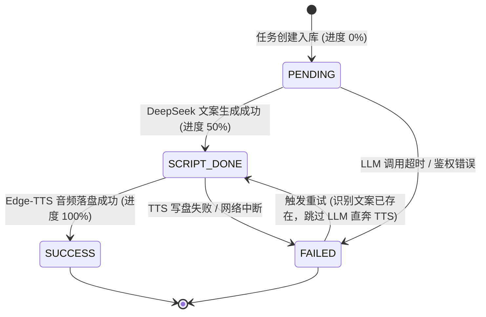

# EchoCraft: AIGC 异步任务调度与短播客生成引擎

[](https://golang.org/)
[](https://gin-gonic.com/)
[](https://gorm.io/)
[](https://www.mysql.com/)
[](https://deepseek.com/)

> **EchoCraft** 是一个面向 AIGC 长耗时场景的高性能、轻量级异步任务编排与短播客生成服务。  
> 客户端提交一个生成主题后，服务端在 **10ms 内极速返回任务单号**；后台基于 **Go 缓冲 Channel 与常驻 Worker 池** 实现削峰消费，全链路串联大语言模型（DeepSeek）文案生成与微软 Edge-TTS 语音合成，最终交付单文件 `.mp3` 播客成果。

---

## 目录
- [一、 业务痛点与架构选型](#一-业务痛点与架构选型)
- [二、 系统架构图与技术全景](#二-系统架构图与技术全景)
- [三、 核心工程亮点](#三-核心工程亮点)
- [四、 目录结构规范 (Uber Go 标准)](#四-目录结构规范-uber-go-标准)
- [五、 快速开始](#五-快速开始)
- [六、 核心 API 接口文档](#六-核心-api-接口文档)
- [七、 常见问题与面试考点 (FAQ)](#七-常见问题与面试考点-faq)

---

## 一、 业务痛点与架构选型

传统的 AIGC Web 服务通常采用同步阻塞调用：
1. **同步阻塞引发 504 熔断**：调用大模型（5~8s）+ 语音合成（3~5s）全链路耗时在 15s 以上。直接在 HTTP 线程中同步等待极易导致网关连接耗尽与 504 Gateway Timeout；
2. **算力与 Token 资金浪费**：若文案生成完毕后在最后的 TTS 阶段因弱网抖动失败，若无检查点机制，二次重试将不得不重新调用大模型，造成算力与 Token 费用的重复浪费；
3. **第三方接口挂死引发协程泄漏**：外部 API 偶发网络挂起时，若无严格的超时熔断机制，后台 Goroutine 将永久阻塞，最终耗尽系统资源。

**EchoCraft 的解法**：  
采用 **“快速入库即刻返回单号 + 内存缓冲 Channel + 固定容量 Worker 协程池 + 断点续跑状态机 + 全链路 Context 熔断”** 彻底解决上述痛点。

---

## 二、 系统架构图与技术全景

### 1. 全链路架构数据流
```mermaid
flowchart TD
    Client["客户端 / Postman"] -- "1. POST /api/v1/tasks (提交主题)" --> Handler["API Handler (参数校验)"]
    Handler -- "2. 委托业务 (CreateTask)" --> Service["TaskService 调度中心"]
    Service -- "3. 调用 DAO 写入 MySQL (状态: PENDING)" --> DB[(MySQL 8.0)]
    Service -- "4. 投递单号 task_id" --> Queue["缓冲 Channel: make(chan string, 100)"]
    Handler -- "5. 极速响应 HTTP 200 (返回单号)" --> Client

    Queue -- "6. 3 个固定常驻 Worker 抢占式消费" --> Worker["后台 Worker 协程池"]

    subgraph Worker 业务流水线 (挂载 30s Context 超时保护)
        Check{"检查数据库已有 script_content？"}
        Check -- "无文案 (首次执行)" --> LLM["调用 DeepSeek 生成 200 字口播文案"]
        LLM --> SaveScript["DAO 更新：持久化文案，推进至 SCRIPT_DONE"]
        SaveScript --> TTS["调用 Edge-TTS 生成单文件 .mp3"]
        Check -- "已有文案 (断点续跑命中)" --> TTS
        TTS --> SaveAudio["DAO 更新：落盘至 storage/，状态推至 SUCCESS"]
    end

    Client -. "7. GET /api/v1/tasks/:task_id (轮询进度)" .-> Handler
    Handler -. "8. 读取最新状态与音频路径" .-> DB
```

### 2. 四态单向有限状态机 (FSM)


---

## 三、 核心工程亮点

### 1. 核心卖点：断点续跑省 Token（Token-Saving Checkpoint）
* **痛点**：TTS 语音合成依赖本地网络与 I/O，极易因临时抖动失败导致任务标为 `FAILED`；
* **设计**：当任务触发重试重新被 Worker 认领时，优先判断 `task.ScriptContent != ""`。若文案已存在，**0ms 跳过 DeepSeek 大模型调用，直接进入配音阶段**，有效避免大模型 Token 成本被重复计费。

### 2. 纯粹的高并发削峰：缓冲通道 + 固定容量 Worker 池
* 放弃开销庞大的分布式中间件，采用 Go 原生并发原语：
  * **缓冲队列**：`make(chan string, 100)` 实现毫秒级平滑削峰；
  * **固定协程池**：服务初始化时常驻开启 3 个 Worker 协程，通过 `for taskID := range taskChan` 竞争抢单，将外部 API 访问压制在安全并发阈值内。

### 3. 全链路生命周期熔断：防止协程与僵尸进程泄漏
* **超时传播**：单次任务调度全流程挂载 `context.WithTimeout(30s)`；
* **子进程安全管控**：调用外部 TTS 命令行时强制使用 `exec.CommandContext(ctx, ...)`，超时瞬间自动向操作系统发送 `SIGKILL` 终止子进程，绝不残留僵尸进程。

---

## 四、 目录结构规范 (Uber Go 标准)

项目遵循清晰的四层单向依赖架构（`Handler -> Service -> DAO -> Model`），坚决杜绝循环引用：

```
echo-craft/
├── internal/
│   ├── api/
│   │   └── task_handler.go      # HTTP 控制层：参数反序列化与路由分发
│   ├── service/
│   │   └── task_service.go      # 核心调度层：缓冲通道、Worker 协程池、断点控制
│   ├── dao/
│   │   └── task_dao.go          # 数据访问层：MySQL GORM 增删改查
│   └── model/
│       └── task.go              # 数据实体定义：Task 结构体与状态枚举
├── pkg/
│   ├── llm/
│   │   └── deepseek.go          # DeepSeek 原生 HTTP 客户端封装 (带超时与防御性判空)
│   └── tts/
│       └── tts.go               # Edge-TTS 系统调用封装 (绑定 CommandContext)
├── storage/                     # 生成的 .mp3 音频文件本地持久化目录
├── .env.example                 # 环境变量模板
├── .gitignore                   # Git 忽略配置 (屏蔽 .env 与生成的音频)
├── go.mod                       # Go 模块管理
├── go.sum
├── main.go                      # 服务唯一启动入口 (仅 30 行组件依赖装配)
└── README.md
```

---

## 五、 快速开始

### 1. 环境依赖
* **Go**：1.22 及以上版本
* **MySQL**：8.0 及以上版本
* **Python**：已安装并具备 `edge-tts` 命令（通过 `pip install edge-tts` 安装）

### 2. 初始化数据库
```sql
CREATE DATABASE IF NOT EXISTS echocraft CHARACTER SET utf8mb4 COLLATE utf8mb4_unicode_ci;
```

### 3. 配置环境变量
在项目根目录下创建 `.env` 文件：
```env
DEEPSEEK_API_KEY=your_deepseek_api_key_here
```

### 4. 运行服务
```bash
# 下载依赖
go mod tidy

# 启动服务 (监听在 9090 端口)
go run main.go
```

---

## 六、 核心 API 接口文档

### 1. 提交生成任务
* **请求**：`POST /api/v1/tasks`
* **Content-Type**：`application/json`
* **请求体**：
  ```json
  {
    "topic": "为什么大厂面试总爱考高并发"
  }
  ```
* **响应**：`HTTP 200 OK` (耗时 < 10ms)
  ```json
  {
    "status": "PENDING",
    "task_id": "task_1793030578589207100"
  }
  ```

### 2. 轮询任务状态与成果
* **请求**：`GET /api/v1/tasks/:task_id`
* **响应**：`HTTP 200 OK`
  ```json
  {
    "code": 200,
    "message": "success",
    "data": {
      "id": 33,
      "task_id": "task_1793030578589207100",
      "topic": "为什么大厂面试总爱考高并发",
      "status": "SUCCESS",
      "script_content": "家人们，为什么大厂面试总爱逮着高并发问？因为大厂不怕你写个增删改查...",
      "audio_path": "storage/task_1793030578589207100.mp3",
      "error_msg": "",
      "created_at": "2026-10-29T20:32:08.513+08:00"
    }
  }
  ```

### 3. 断点重试任务
* **请求**：`POST /api/v1/tasks/:task_id/retry`
* **响应**：`HTTP 200 OK` (自动跳过文案生成，仅重试配音)
  ```json
  {
    "message": "重试任务已进入后台排队",
    "task_id": "task_1793030578589207100"
  }
  ```

---

## 七、 常见问题与面试考点 (FAQ)

### Q1: 为什么不用消息队列（如 RabbitMQ / Kafka），而用内存 Channel？
> **答**：EchoCraft 定位为轻量级、低心智负担的单体服务。在并发量可预期的场景下，Go 原生带缓冲的 Channel 性能最高（纯内存操作、纳秒级唤醒），无需搭建和维护庞大的外部中间件。系统通过落库持久化 `PENDING` 状态防丢单，兼顾了极致性能与工程精简性。

### Q2: 如果第三方 API 响应变慢，如何防止后台 Worker 永久卡死？
> **答**：全链路采用 `context.WithTimeout`（30s 熔断保护）。不仅大模型 HTTP 请求绑定了 Context，而且在启动外部 `edge-tts` 进程时严格使用 `exec.CommandContext`。一旦超时触发，Go 会自动向操作系统发出终止信号杀死子进程，同时关闭网络连接，彻底杜绝协程泄漏与僵尸进程。

### Q3: 为什么死循环 Worker 消费中不使用 `defer cancel()`？
> **答**：Go 的 `defer` 语句仅在外层函数退出时执行。由于 Worker 是 `for` 无限循环常驻协程，如果在死循环内使用 `defer`，每次循环创建的 Context 计时器资源将永远积攒无法释放，引发内存泄漏。因此在循环体内必须在单次任务执行完毕后**显式手动调用 `cancel()`**。
